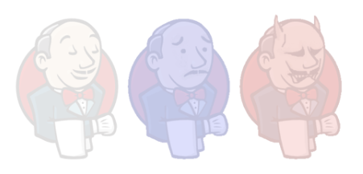

# Jenkins Emotional Plugin

## What is it

Emotional Jenkins is a fun Jenkins plugin that changes Mr. Jenkins' background expression based on the result of your builds.
When a build fails, Jenkins gets angry. When a build is unstable, he looks sad. And when everything goes well, he keeps his usual smile.

A little personality for your Jenkins dashboard!

## Table of Contents

- [Configuration](#configuration)
- [Expressions](#expressions)
  - [Successful Build](#successful-build)
  - [Unstable Build](#unstable-build)
  - [Failed Build](#failed-build)
- [Requirements](#requirements)
- [Contributing](#contributing)
- [License](#license)

## Configuration 

To enable Emotional Jenkins for a job:

1. Open your Jenkins job.
2. Click **Configure**.
3. Navigate to the **Post-build Actions** section.
4. Click **Add post-build action**.
5. Select **Emotional Jenkins**.
6. Save your configuration.

Once enabled, Emotional Jenkins automatically updates Mr. Jenkins' background expression based on the build result.

## Expressions

Emotional Jenkins changes Mr. Jenkins' appearance according to the outcome of your builds.

### Successful Build

When a build succeeds, Mr. Jenkins keeps his happy expression.

### Unstable Build

When a build is unstable, Mr. Jenkins looks sad.

### Failed Build

When a build fails, Mr. Jenkins gets angry.

## Requirements

- Java 25 or later.
- Jenkins compatible with the plugin's configured Jenkins baseline.

## Contributing

Contributions are welcome!

1. Fork the repository.
2. Create a branch for your changes.
3. Make your changes and add tests when applicable.
4. Run the test suite using `mvn clean verify`.
5. Submit a pull request with a clear description of your changes.

Please ensure that your changes follow the project's coding standards.

## License

This project is licensed under the [MIT License](LICENSE).