# Emotional Jenkins plugin

[](https://plugins.jenkins.io/emotional-jenkins-plugin/)
[](https://github.com/jenkinsci/emotional-jenkins-plugin/releases/latest)
[](https://plugins.jenkins.io/emotional-jenkins-plugin/)
[](LICENSE.txt)

<a href="https://jenkins.io">
    
</a>

## What it is

Mr. Jenkins has feelings too.

This plugin lets him show them: after every build, Mr. Jenkins appears in the side panel and reacts to the result.
He is happy when the build succeeds, worried when it is unstable, angry when it fails, and disappointed when it is aborted.

<p>
  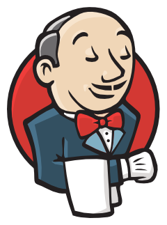
  
  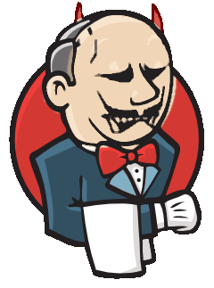
  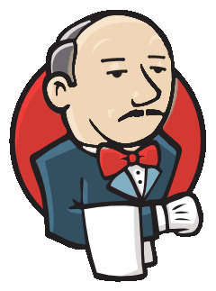
</p>

It works with Freestyle jobs and with Declarative and Scripted Pipelines.

## Table of Contents

- [Download & Installation](#download--installation)
- [Usage](#usage)
  - [Freestyle jobs](#freestyle-jobs)
  - [Pipeline jobs](#pipeline-jobs)
  - [Job DSL and Configuration as Code](#job-dsl-and-configuration-as-code)
- [Moods](#moods)
- [Screenshots](#screenshots)
  - [Dark theme](#dark-theme)
- [Requirements](#requirements)
- [Release Notes](#release-notes)
- [Contributing](#contributing)
- [Credits](#credits)
- [Maintainers](#maintainers)
- [License](#license)

## Download & Installation

Install the plugin from the Jenkins Plugin Manager (_Manage Jenkins > Plugins > Available plugins_, search for **Emotional Jenkins**),
or download the [latest .hpi](https://updates.jenkins.io/latest/emotional-jenkins-plugin.hpi) and upload it via _Manage Jenkins > Plugins > Advanced settings_.

## Usage

### Freestyle jobs

1. Open the job's configuration page.
2. In **Post-build Actions**, click **Add post-build action** and select **Emotional Jenkins**.
3. Save, then run a build. Mr. Jenkins appears in the side panel of the build page and the job page.

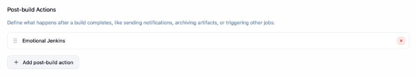

### Pipeline jobs

Add the `emotionalJenkins()` step to your Jenkinsfile. In a Declarative Pipeline, put it in `post { always { ... } }`
so it runs whatever the outcome:

```groovy
pipeline {
    agent any
    stages {
        stage('Build') {
            steps {
                sh './gradlew build'
            }
        }
        stage('Test') {
            steps {
                sh './gradlew test'
            }
        }
    }
    post {
        always {
            emotionalJenkins()
        }
    }
}
```

In a Scripted Pipeline, call it at the end, using `try`/`finally` so it also runs when the build fails:

```groovy
node {
    try {
        stage('Build') {
            sh 'make'
        }
    } finally {
        emotionalJenkins()
    }
}
```

Good to know:

- Mr. Jenkins shows the **final** result of the build, even though the step runs before the build has finished.
  A build that fails after the step was called still makes him angry.
- The step does not need an agent or a workspace, so it also works with `agent none`.
- On the job page, Mr. Jenkins shows the mood of the last completed build that used the plugin.

### Job DSL and Configuration as Code

With [Job DSL](https://plugins.jenkins.io/job-dsl/), add the `emotionalJenkins()` publisher to a freestyle job:

```groovy
freeStyleJob('my-app') {
    publishers {
        emotionalJenkins()
    }
}
```

[Configuration as Code](https://plugins.jenkins.io/configuration-as-code/) creates jobs through Job DSL scripts, so the same snippet works in its `jobs:` section:

```yaml
jobs:
  - script: >
      freeStyleJob('my-app') {
        publishers {
          emotionalJenkins()
        }
      }
```

For Pipeline jobs created this way, call the `emotionalJenkins()` step in the Jenkinsfile, as shown above.

## Moods

| Build result        | Mood         | Mr. Jenkins |
|---------------------|--------------|-------------|
| Success             | Happy        |  |
| Unstable            | Worried      |  |
| Failure             | Angry        |  |
| Aborted / not built | Disappointed |  |

## Screenshots

These screenshots come from Declarative Pipelines that use `emotionalJenkins()` in `post { always { ... } }`.

| Success | Unstable |
|---------|----------|
| 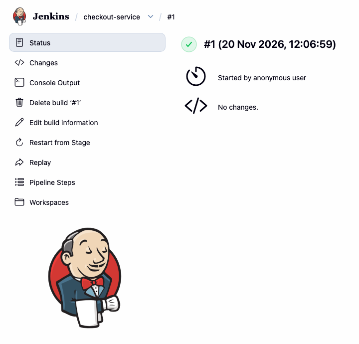 | 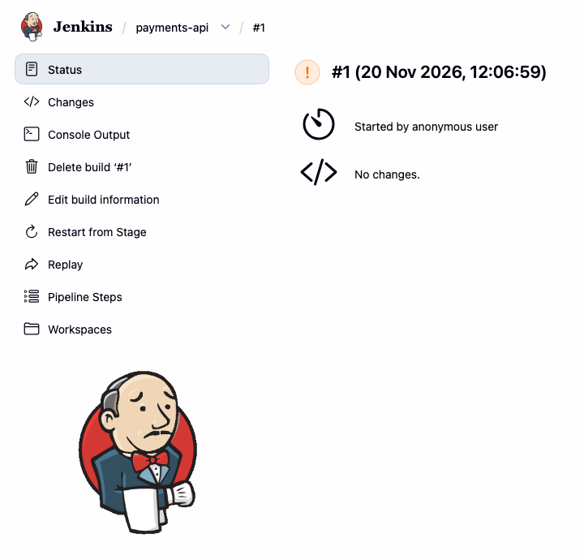 |
| **Failure** | **Aborted** |
| 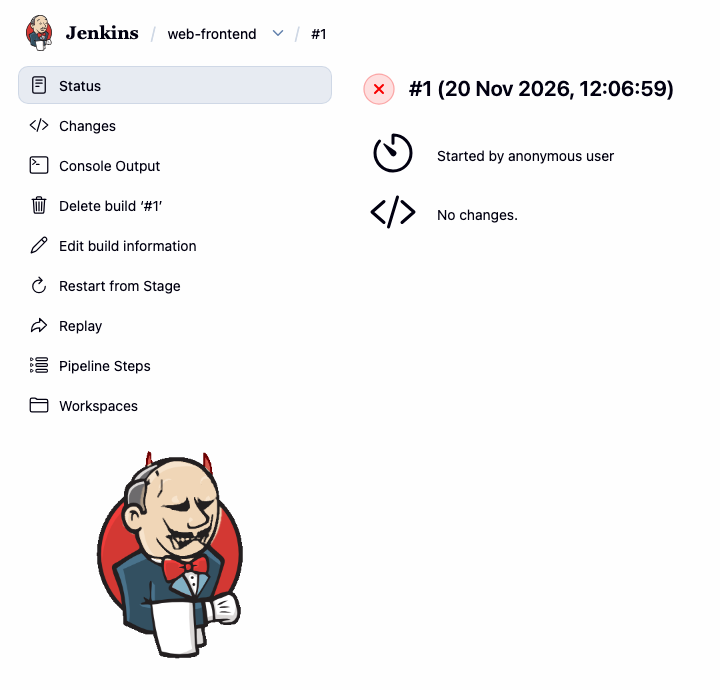 | 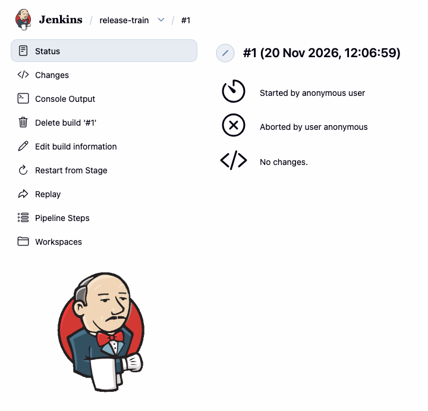 |

Mr. Jenkins also appears on the job page, showing the mood of the latest build:

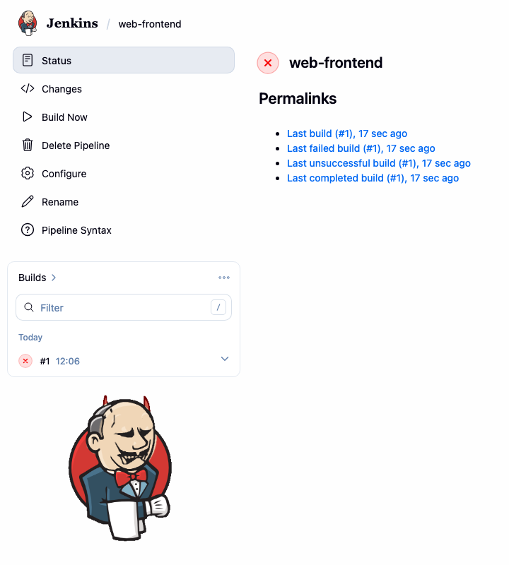

### Dark theme

The mood images have transparent backgrounds, so Mr. Jenkins also looks right with the
[Dark Theme](https://plugins.jenkins.io/dark-theme/):

| Success | Unstable |
|---------|----------|
| 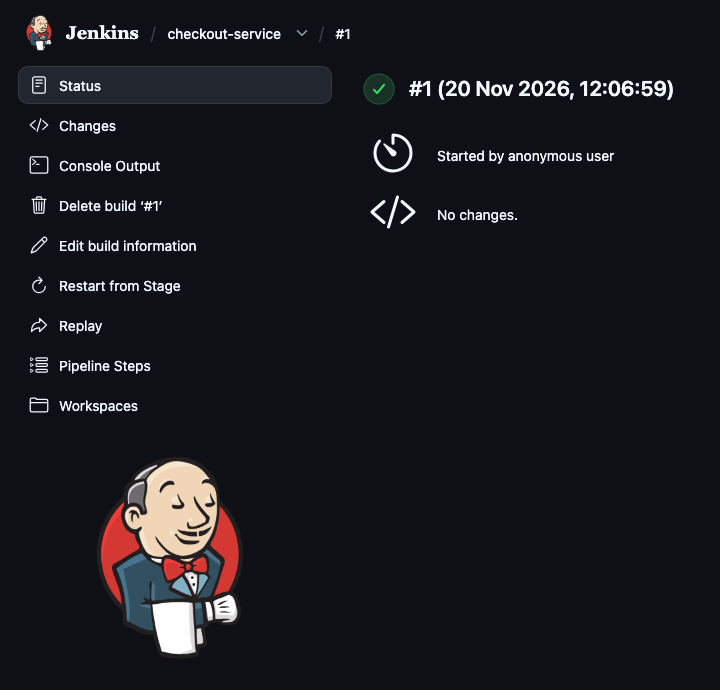 | 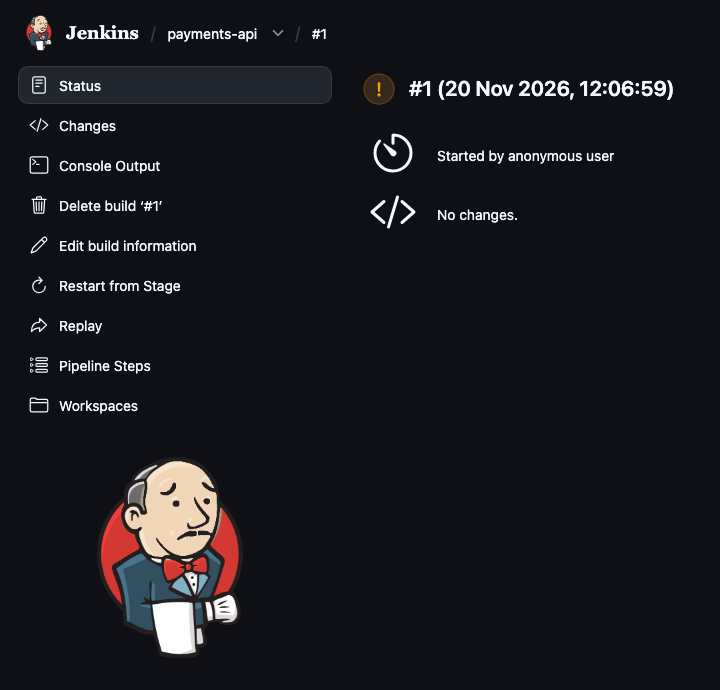 |
| **Failure** | **Aborted** |
| 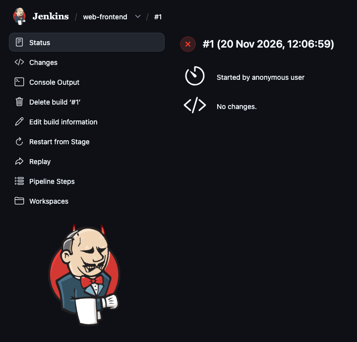 | 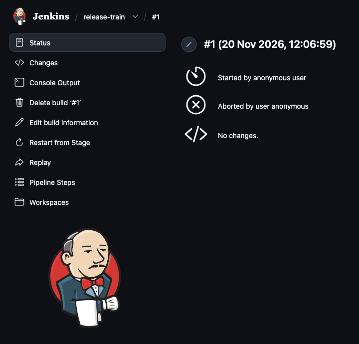 |

## Requirements

- Jenkins 2.580.2 or newer
- Java 21 or newer

## Release Notes

See [GitHub Releases](https://github.com/jenkinsci/emotional-jenkins-plugin/releases).

## Contributing

Contributions are welcome! See [CONTRIBUTING.md](CONTRIBUTING.md) for details.

To try your changes locally, run:

```shell
mvn hpi:run
```

and open <http://localhost:8080/jenkins/>. Run the full test suite with `mvn clean verify`.

## Credits

* Originally created by [Masanobu Imai](https://github.com/masanobuimai).
* The mood images are based on the plugin's original artwork and the [Jenkins logo](https://www.jenkins.io/artwork/) by Charles Lowell and Frontside, licensed under [CC BY-SA 3.0](https://creativecommons.org/licenses/by-sa/3.0/).
* Inspiration for the [Chuck Norris plugin](https://plugins.jenkins.io/chucknorris/).

## Maintainers

This plugin is actively maintained. Co-contributors and feedback are welcome — please open an [issue](https://github.com/jenkinsci/emotional-jenkins-plugin/issues) or pull request.

## License

This project is licensed under the [MIT License](LICENSE.txt).

---

[Jenkins community](https://www.jenkins.io/participate/) • [Report a bug](https://github.com/jenkinsci/emotional-jenkins-plugin/issues)
